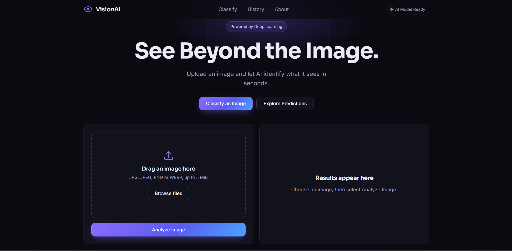
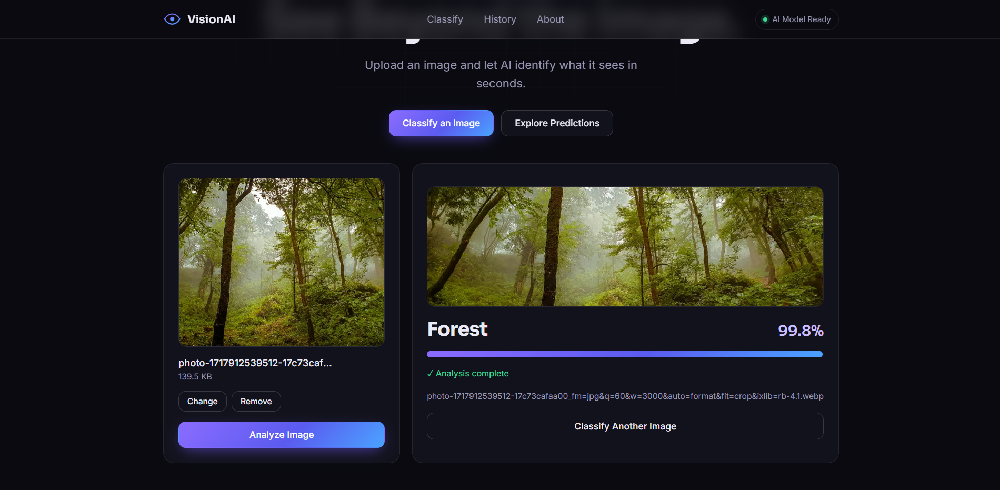
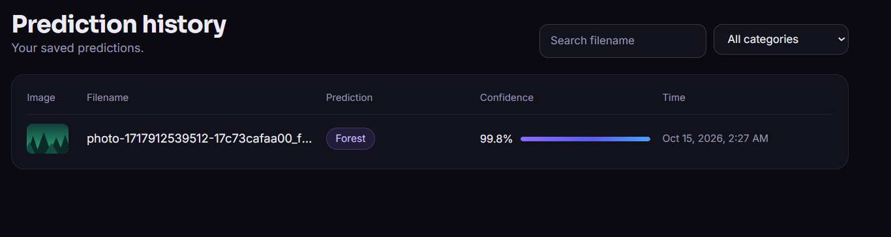
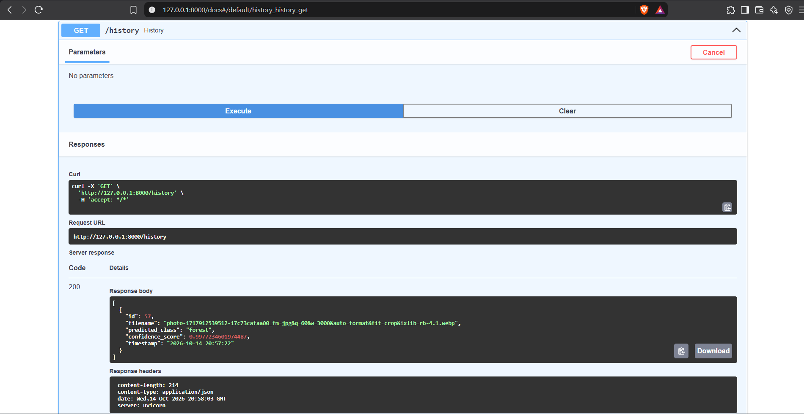

# 🏔️ VisionAI — Image Classification API

An end-to-end image classification application powered by a Convolutional Neural Network (CNN), TensorFlow/Keras, FastAPI, and SQLite. VisionAI allows users to upload images through a web interface, receive predictions, and view their prediction history.

## ✨ Features

- 🧠 **CNN Image Classification** — Classifies images into six scene categories.
- 🖼️ **Image Upload** — Upload images through an interactive web interface.
- ⚡ **FastAPI Backend** — Provides REST API endpoints for image prediction and history.
- 📊 **Prediction Results** — Displays the predicted class and model score.
- 🕒 **Timestamps** — Records when predictions are made.
- 🗃️ **SQLite Database** — Persists prediction history locally.
- 📜 **Prediction History** — View previous predictions.
- 🧪 **Automated Tests** — Test API endpoints and image validation.
- 📈 **Training Visualizations** — Includes accuracy and loss plots.

## 🖼️ Application Preview

### Home Page



### Image Classification



### Prediction History



### API Documentation

FastAPI automatically generates interactive API documentation.



> Ensure these screenshot filenames exist in your `images/` directory. Replace any filename with the correct one if your screenshots use different names.

## 🎯 Supported Categories

The CNN classifies images into six categories:

| Category | Description |
|---|---|
| Buildings | Urban buildings and structures |
| Forest | Forest and woodland scenes |
| Glacier | Glaciers and icy landscapes |
| Mountain | Mountainous landscapes |
| Sea | Sea and coastal scenes |
| Street | Roads and street scenes |

## 🏗️ Architecture

VisionAI connects a trained deep learning model to a web application through a REST API.

```text
User
 │
 ▼
Frontend (HTML, CSS, JavaScript)
 │
 │ HTTP Request
 ▼
FastAPI Backend
 │
 ├── Image Validation and Preprocessing
 │
 ├── TensorFlow/Keras CNN
 │        │
 │        ▼
 │   Predicted Class and Score
 │
 └── SQLite Database
          │
          ▼
     Prediction History
```

### Technology Stack

| Component | Technologies |
|---|---|
| Frontend | HTML, CSS, JavaScript |
| Backend | Python, FastAPI, Uvicorn |
| Deep Learning | TensorFlow, Keras |
| Image Processing | Pillow, NumPy |
| Database | SQLite |
| Testing | Pytest, HTTPX |
| Visualization | Matplotlib |

## 🧠 Model Architecture

The original CNN uses the following architecture:

- Image resizing to `150 × 150 × 3`
- Data augmentation using random horizontal flips, rotation, and zoom
- Rescaling of pixel values
- Convolutional layers with 32, 64, and 128 filters
- Max pooling
- Flatten layer
- Dense layer with 128 units
- Dropout regularization
- Six-class output layer

The trained model is stored at:

```text
models/intel_cnn.keras
```

### Model Summary


## 📊 Model Performance

The original standalone classifier achieved a reported test accuracy of **85.86%**.

### Training and Validation Accuracy


### Training and Validation Loss


These metrics describe the original model evaluation. Update them if the model has been retrained or evaluated differently in the upgraded version.

## 🔌 API Endpoints

The backend exposes the following endpoints.

| Method | Endpoint | Purpose |
|---|---|---|
| `GET` | `/` | Check whether the API is running |
| `POST` | `/predict` | Upload an image and obtain a prediction |
| `GET` | `/history` | Retrieve prediction history |

### Interactive API Documentation

After starting the backend, visit:

```text
http://127.0.0.1:8000/docs
```

You can inspect endpoints, upload test images, and view API responses using Swagger UI.

### Example Prediction Request

```bash
curl -X POST "http://127.0.0.1:8000/predict" \
  -F "file=@Prediction_Samples/glacier.jpg"
```

The response structure depends on the API's Pydantic schema. It includes the prediction information returned by the backend.

## 📂 Project Structure

```text
Image-Classification/
│
├── frontend/
│   ├── assets/
│   ├── index.html
│   ├── script.js
│   └── style.css
│
├── images/
│   ├── summary.png
│   ├── prediction.png
│   ├── training_validation_accuracy.png
│   ├── training_validation_loss.png
│   └── ...application screenshots
│
├── models/
│   └── intel_cnn.keras
│
├── Prediction_Samples/
│   ├── glacier.jpg
│   ├── mount_chillad.jpg
│   └── nyc.jpg
│
├── main.py
├── database.py
├── schemas.py
├── predict.py
├── train.py
├── test_api.py
├── requirements.txt
├── .gitignore
└── README.md
```

The local SQLite database is generated by the application and is not committed to the repository. The training dataset is also excluded because of its size.

## ⚙️ Installation and Setup

### 1. Clone the repository

```bash
git clone https://github.com/Ankit-20285/Image-Classification.git
cd Image-Classification
```

### 2. Create a virtual environment

```bash
python -m venv .venv
```

Activate it on Windows:

```bash
.venv\Scripts\activate
```

On macOS/Linux:

```bash
source .venv/bin/activate
```

### 3. Install dependencies

```bash
python -m pip install -r requirements.txt
```

### 4. Start the FastAPI server

```bash
uvicorn main:app --reload
```

Open the frontend using your preferred local development server and ensure that its API base URL points to the running backend.

- API: `http://127.0.0.1:8000`
- Swagger documentation: `http://127.0.0.1:8000/docs`

> **Note:** The frontend and backend must be configured to communicate with each other. Follow the API URL and CORS settings in the application code if you run them on different ports.

## 🧪 Running Tests

Run the automated API tests from the project root:

```bash
python -m pytest test_api.py -v
```

The tests cover API responses, prediction behavior, invalid image uploads, and related validation.

## 🏋️ Training the Model

The trained model is included in the repository, so retraining is not required to run predictions.

To train the CNN yourself:

1. Download the [Intel Image Classification Dataset](https://www.kaggle.com/datasets/puneet6060/intel-image-classification).
2. Configure the dataset path in `train.py`.
3. Install the required training dependencies.
4. Run:

```bash
python train.py
```

Ensure the training script saves the model to the location expected by the API and prediction script.

## 🔍 Standalone Prediction

You can also use the standalone prediction script:

```bash
python predict.py
```

Update the image path in `predict.py` if you want to classify a different image.

## 🗃️ Database and Prediction History

Prediction metadata is stored in a local SQLite database.

- The database is initialized by the application according to its database setup code.
- Prediction history persists locally across server restarts while the database file remains intact.
- A fresh local installation should start with an empty database.
- The database file is excluded from Git to avoid publishing local prediction history.

This setup is intended for local use. A public multi-user deployment would need appropriate persistent storage and per-user access controls if prediction history is private.

## 📦 Dataset

This project uses the [Intel Image Classification Dataset on Kaggle](https://www.kaggle.com/datasets/puneet6060/intel-image-classification).

The dataset contains natural and urban scene images across the six supported categories. The dataset itself is not included in this repository.

## 🚀 Future Improvements

- Deploy the frontend and API
- Add user authentication and private prediction histories
- Improve image-history thumbnails and storage
- Explore transfer learning with MobileNetV2 or EfficientNet
- Add more robust model evaluation and error handling
- Improve API integration and automated test coverage

## 👨‍💻 Author

**Ankit Singh**

This project demonstrates the integration of deep learning, REST APIs, database persistence, and frontend development into an end-to-end image classification application.

---

If you find this project useful, consider giving the repository a ⭐ on GitHub.
