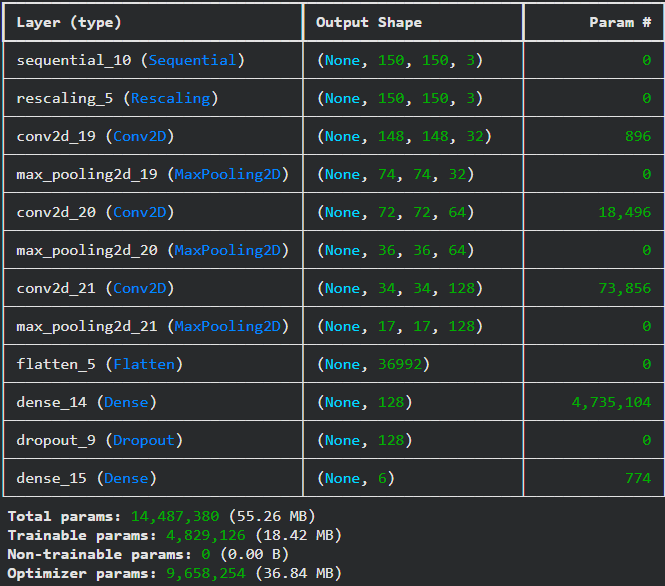
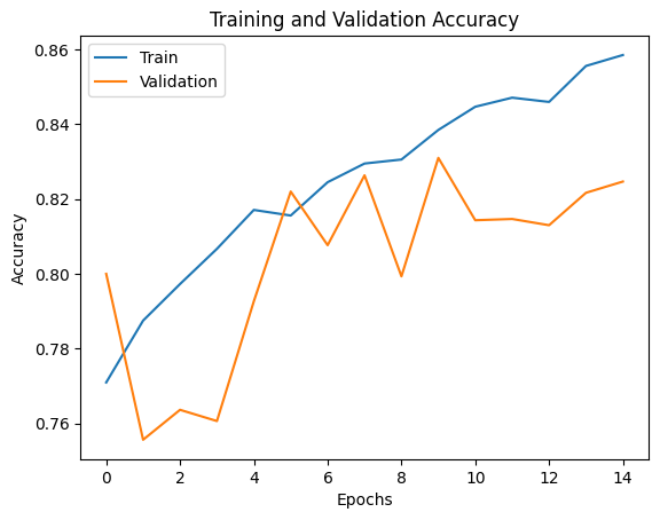
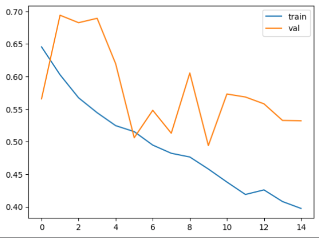
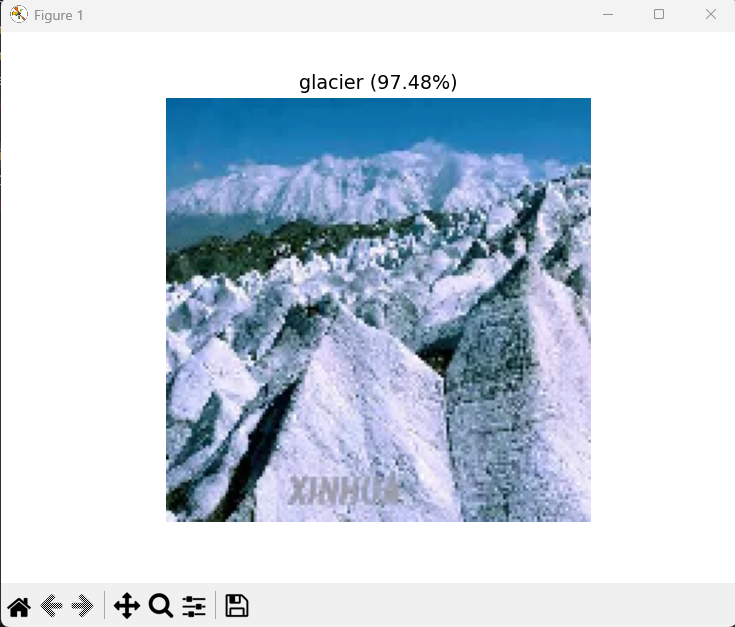

# 🏔️ Image Classification using CNN

A Deep Learning project to classify images into six different categories using a Convolutional Neural Network (CNN) built with TensorFlow and Keras.

---

## 📌 Project Overview

This project uses a Convolutional Neural Network (CNN) to classify natural and urban scene images into six different categories.

The model was trained to recognize:

* 🏢 Buildings
* 🌲 Forest
* 🧊 Glacier
* 🏔️ Mountain
* 🌊 Sea
* 🛣️ Street

The project includes:

* Data Augmentation
* Image Rescaling
* CNN Architecture Design
* Model Training & Validation
* Model Saving and Loading
* Prediction on Custom Images
* Training Visualization

This project demonstrates an end-to-end workflow for **multi-class image classification** using Deep Learning.

---

## 🧠 How It Works

1. Load the image dataset
2. Apply data augmentation techniques
3. Rescale image pixel values
4. Resize images to `150 × 150`
5. Build a CNN architecture using TensorFlow/Keras
6. Train the model 
7. Evaluate the model using test data
8. Save the trained model
9. Load the model for future predictions
10. Predict the class of custom images

---

## 📂 Project Structure

```text
Image-Classification/
│
├── images/
│   ├── prediction.png
│   ├── summary.png
│   ├── training_validation_accuracy.png
│   └── training_validation_loss.png
│
├── models/
│   └── intel_cnn.keras
│
├── Prediction_Samples/
│   ├── glacier.jpg
│   ├── mount_chillad.jpg
│   └── nyc.jpg
│
├── .gitignore
├── predict.py
├── README.md
├── requirements.txt
└── train.py
```

> The dataset is not included in this repository because of its size.

---

## 📊 Model Architecture

The CNN architecture consists of:

* Data Augmentation

  * Random Horizontal Flip
  * Random Rotation
  * Random Zoom
* Rescaling Layer
* Conv2D — 32 Filters
* MaxPooling2D
* Conv2D — 64 Filters
* MaxPooling2D
* Conv2D — 128 Filters
* MaxPooling2D
* Flatten Layer
* Dense Layer — 128 Units
* Dropout — 30%
* Output Layer — 6 Classes

### Input Image

```text
150 × 150 × 3
```

### Model Summary



---

## 📈 Training Results

### Training & Validation Accuracy



### Training & Validation Loss



### Final Test Accuracy

```text
Test Accuracy: 85.86%
```

---

## 🎯 Sample Predictions

The trained model can classify custom images belonging to the six classes.

Example:

```text
Prediction_Samples/glacier.jpg
Prediction_Samples/mount_chillad.jpg
Prediction_Samples/nyc.jpg
```

### Prediction Examples



---

## 📦 Dataset

Dataset used: https://www.kaggle.com/datasets/puneet6060/intel-image-classification

**Intel Image Classification Dataset**

The dataset contains images belonging to six different scene categories:

* Buildings
* Forest
* Glacier
* Mountain
* Sea
* Street

> The dataset is not included in this repository due to its large size.

To run the project, download the dataset and update the `DATASET` path in `train.py`.

---

## 🛠 Technologies Used

* Python
* TensorFlow
* Keras
* NumPy
* Matplotlib
* Scikit-learn

---

## ⚙️ Installation

Clone the repository:

```bash
git clone https://github.com/Ankit-20285/Image-Classification.git
cd Image-Classification
```

Install the required dependencies:

```bash
pip install -r requirements.txt
```

---

## 🚀 Training

Before training, set the dataset path in `train.py`:

```python
DATASET = "path/to/your/dataset"
```

Then run:

```bash
python train.py
```

This will:

* Load the dataset
* Apply image preprocessing and augmentation
* Train the CNN
* Validate the model
* Save the trained model

---

## 🔍 Prediction

After training, place a custom image in the prediction folder and run:

```bash
python predict.py
```

Example output:

```text
Predicted Class: Mountain
Confidence: XX.XX%
```

---

## 📌 Future Improvements

* Transfer Learning using MobileNetV2
* Fine-tuning pre-trained CNN models
* Experiment with ResNet / EfficientNet
* Improve model accuracy
* Add a Streamlit web interface
* Real-Time Webcam Prediction
* Model Deployment

---

## 👨‍💻 Author

**Ankit Singh**

A Deep Learning project focused on understanding **CNNs and multi-class image classification**. 🚀
